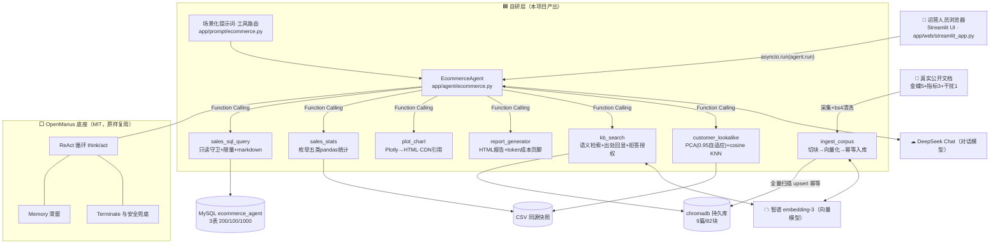

# 电商运营数据分析智能体

> 输入一句中文业务问题 → Agent 自动查数 / 统计 / 画图 → 输出带图表与出处的 HTML 分析报告。
>
> **6 个自研工具 ｜ RAG 知识库（9 篇文档 / 82 个语义块 / 平均 294 字）｜ 单次端到端 ≈ ¥0.05**


## 演示

> 🎬 **[▶️ 演示视频（1 分 40 秒）](docs/demo/W4-演示视频-库存口径问答.webm)**：一句话提问 → Agent 执行时间线 → 带出处的报告生成与下载。GitHub 不内嵌 webm 播放器——点开若提示下载，存本地用浏览器打开即是完整体验。

## 它解决什么问题

电商运营做日常复盘时，取数靠手工导表、跨表核对、口径靠问人——**一个"上月哪个品类卖得好"要花半小时**。

本项目把这条链路压缩成**一句话**：运营人员不需要会 SQL，输入自然语言问题，即可获得带图表、带结论、**带数据来源引用**的分析报告。业务口径类问题（如"复购率怎么算"）由 RAG 知识库作答，**回答必附出处；无依据时如实说明，不编造**。

## 架构



## 核心能力

- **6 个自研工具接入 Agent**：只读 SQL 查询（**三层安全防御**）、pandas 统计分析、Plotly 交互图表、HTML 报告生成（含 token 成本页脚）、RAG 知识库检索、相似客户分析（PCA + KNN）；由大模型经 Function Calling 选用，提示词含问题分流规则（数字类→查库、口径类→知识库、相似人群类→lookalike）
- **RAG 知识库**：9 篇真实公开文档 → 82 个语义块（**幂等入库**，重跑结果一致）；回答带来源引用；**无关问题实测正确拒答**
- **检索调优**：定位切块过碎问题（平均 **40 → 294 字**）；发现向量检索分数无区分度（相关 0.842 / 不相关 0.797）后，将相关性判断交由大模型结合上下文处理
- **可观测与评测**：**23 条自动化测试用例**（18 条纯本地 / 2 条含数据库 / 3 条真实 API·live 门控；含守卫绕过、尾分号、字段级校验与 top_k 边界回归固化）；每步执行日志可追溯；token 成本统计（单次端到端 ≈ ¥0.04–0.05 为演示实测估算，随问题复杂度与输入长度浮动）
- **RAG 检索评测**：自建 20 题评测集（基础 15 题 + 口语化 5 题·刻意不用文档原词），**top-3 来源命中率 100%**——口径注意：判定的是"正确来源文档出现在 top-3"，衡量检索层召回，不等同于最终回答正确率（回答质量另需端到端评估）
- **Web 界面**：Streamlit 一句话输入 → 回答 + 报告链接 + 执行过程展开

**深度自查**（本项目相对"跑通 Demo"的追加项，全部有代码/测试/截图对应）：自研 ≥4 工具 ✓（6）· 真实知识库 ✓（禁 AI 生成）· 场景化提示词 ✓ · 自有模块标注 ✓ · 自动化测试 ✓ · 三层安全防御含权限兜底 ✓

## 快速开始

> 以 PowerShell（Windows）为例，五步从零到跑通。**第 1、3、4 步只需做一次**（初始化），第 5 步是日常运行。

```powershell
# ── 1. 底座与解释器（一次性）──────────────────────────
# 本仓库不内含 OpenManus 框架，需要先准备它（uv 会自动建 .venv）：
git clone https://github.com/FoundationAgents/OpenManus.git
cd OpenManus; uv sync; cd ..          # 装好后解释器在 <OpenManus>\.venv\Scripts\python.exe
# 把 DeepSeek API key 填入 OpenManus\config\config.toml 的 [llm] 段

# ── 2. 本项目依赖（一次性）────────────────────────────
uv pip install -r requirements.txt --python <OpenManus路径>\.venv\Scripts\python.exe

# ── 3. 数据初始化（一次性）：建 3 表 + 灌入 200/100/1000 行 + 建只读账号 ──
$env:MYSQL_PASSWORD = "<root密码>"
python scripts/w2_setup/one_click_init.py
#    只读账号 ecom_ro 按 scripts/w2_setup/README.md 中 SQL 创建（GRANT SELECT）

# ── 4. 知识库构建（一次性）─────────────────────────────
#    语料位置：$env:ECOM_RAW_DIR（默认 <项目盘>\knowledge\raw，本仓库不含语料原文，
#    9 篇清单与 URL 见 data/knowledge/MANIFEST.csv，自行采集后放入）
#    本步会调用智谱 embedding（产生少量费用），产出 82 块向量库到 ECOM_KB_DIR
$env:ZHIPU_API_KEY = "sk-..."
python scripts/w3_setup/ingest_corpus.py

# ── 5. 运行（日常）：环境变量必须在同一终端窗口设置 ─────
$env:MYSQL_RO_USER = "ecom_ro"; $env:MYSQL_RO_PASSWORD = "<只读密码>"; $env:ZHIPU_API_KEY = "sk-..."
# 命令行：
python scripts/run_agent.py "分析月度销售趋势并生成报告"
# 或 Web 界面（浏览器自动打开 http://localhost:8501）：
python -m streamlit run app/web/streamlit_app.py
```

> 🔐 **账号分工**：root 仅用于第 3 步建表；日常查询全部走 `ecom_ro` 只读账号（仅 `GRANT SELECT`）——数据库权限层是守卫之外的第二道兜底，也是"三层防御"的第三层。

> ⚙️ **换机器/换目录**：只需覆盖这几个环境变量（不设则用演示机默认值），然后重跑第 4 步即可——
> `OPENMANUS_HOME`（OpenManus 根目录）· `ECOM_DATA_DIR`（CSV 数据）· `ECOM_RAW_DIR`（语料）· `ECOM_KB_DIR`（向量库）。

**常见报错速查**

| 症状 | 先查什么 |
|---|---|
| `1045 / 1142` | 只读账号密码错 / 1142=权限层正确拒绝了写操作（是好事） |
| "知识库打开失败" | 第 4 步没跑，或 `ECOM_KB_DIR` 指错 |
| HTTP 429 | 读**响应体业务码**再动手：1113=欠费充值 / 1302=限流（脚本已内置间隔+退避）/ 1308=额度上限 |
| 启动即报环境变量未设 | 没在同一终端设置——双击 .bat 会开新进程丢变量，故本 README 不用 bat |

## 测试

```powershell
$env:MYSQL_RO_PASSWORD = "<只读密码>"; $env:ZHIPU_API_KEY = "sk-..."   # 全绿需这两把钥匙在场
python -X utf8 tests/test_tools.py      # 期望 PASS 23 / FAIL 0 / SKIP 0
python -X utf8 tests/eval_rag.py        # RAG 检索评测 20 题（需 ZHIPU_API_KEY）
```

**三档口径**（哪些测试要什么环境）：18 条纯本地（任何机器直接跑）· 2 条含数据库（需 MySQL 已初始化 + `MYSQL_RO_PASSWORD`）· 3 条 live 门控（检测到 `ZHIPU_API_KEY` 才真跑，否则显式 SKIP 不误伤）。

> ⚠️ **2 条含数据库用例在未设 `MYSQL_RO_PASSWORD` 时是 FAIL（不是 SKIP）**——有意设计：**环境缺失应当显式报错，而不是静默跳过**（静默 SKIP 会让人误以为"已经跑过"）。

检索评测统计口径见"核心能力"节：top-3 命中 = 检索召回指标，不等同端到端回答正确率。

## 已知限制

- **单用户演示定位**：未做并发、多租户与压测；本机可跑的作品集 demo，不是生产服务（生产化方向见"后续规划"）。
- **默认路径绑定演示机**：四个环境变量的默认值指向演示机目录，换机需按"快速开始"覆盖，否则报"路径不存在/知识库打开失败"。
- **语料原文不随仓**：9 篇真实公开文章因版权不入 git，仓内只保留 `data/knowledge/MANIFEST.csv` 清单与出处元数据，需按清单自行采集后再跑第 4 步。
- **检索评测是召回口径**：`eval_rag.py` 20 题 top-3 命中 100% ≠ 端到端回答正确率 100%，前者只证明"正确文档被排进前三"。
- **成本为估算值**：≈¥0.05/次 由报告页脚 token 数 × 单价推得，非账单实测。
- **双数据源需手动对齐**：MySQL 业务数据与知识库向量库是两份快照，换数据后要重跑 ingest，否则口径脱节。

## 技术要点与踩坑精选

1. **切块参数"写了 ≠ 生效"**：首版切块平均仅 40 字——`max_len=500` 一次都没触发（标题太密）。改为"内容攒够 200 字再切"后升至 294 字，命中内容从"只有标题"变为完整段落。
2. **向量检索分数无区分度**：完全不相关的文档也能拿 0.797（正确答案 0.842，仅差 0.045）→ 结论：**向量检索是"排序器"不是"打分器"**，绝对分数不可靠、排序可靠；改为"分数交给模型 + 提示词授权其说'不知道'"。
3. **token 统计曾是全局累计**：LLM 是进程级单例、计数从不重置，连问第二个问题时报告页脚会变成两次之和 → **在 Agent 入口把计数清零**，每轮任务从零开始计。

## 自有模块标注（本项目产出 vs 开源底座）

**本仓库自研**：

| 模块 | 说明 |
|---|---|
| `app/tool/sales_sql_query.py` | 只读 SQL 查询 + 三层安全防御（提示词约束 / 代码守卫 / 数据库只读账号） |
| `app/tool/sales_stats.py` | 5 类预设统计（月度 / 品类 / 用户 / Top商品 / 复购率） |
| `app/tool/plot_chart.py` | 5 种 Plotly 交互图表，列名校验 + 路径返回 |
| `app/tool/report_generator.py` | HTML 报告生成（图表嵌入 + token 成本页脚 + 缺失图表降级） |
| `app/tool/kb_search.py` | RAG 语义检索（出处回显 + 相关性判断授权） |
| `app/tool/customer_lookalike.py` | 相似客户分析（特征矩阵 → 标准化 → PCA → cosine KNN） |
| `scripts/w3_setup/ingest_corpus.py` | 语料切块 → 向量化 → 幂等入库 |
| `app/agent/ecommerce.py` · `app/prompt/ecommerce.py` | Agent 装配（工具注册 / 每轮 token 计数清零）+ 场景化提示词 |
| `app/web/streamlit_app.py` | Web 界面 |
| `tests/` | 23 条自动化测试用例 |

**OpenManus 底座（MIT 协议，原样复用）**：ReAct 循环（`think` / `act`）、工具基类与注册机制、LLM 封装与单例计数、消息与记忆机制、卡死检测与 `max_steps`。

## 后续规划（设计已想清，**未实施**）

容器化上线的设想：镜像分层（slim 基础层/依赖层/应用层）· 向量库与产物挂 volume、密钥只注入不烧录 · compose 编排 mysql+agent 双服务 + healthcheck。当前定位是**单用户演示应用**，这些不在必做路径上；API 服务化经评估暂不采用（用不上并发与鉴权）。（注：本节是规划，不是已完成能力。）

## 数据说明

- **数据源**：MySQL `ecommerce_agent`（3 表：Customers 200 / Products 100 / Transactions 1000）+ 同源 CSV 快照（统计与 ML 工具不依赖数据库，便于离线运行）
- **三消费者两数据源**：SQL 工具读 MySQL，统计与 ML 工具读 CSV——**改一处数据必须重跑 `one_click_init.py` 全量刷新**（该脚本幂等）
- **知识库语料**：9 篇真实公开文档（金蝶官方帮助文档 5 篇 + 商业百科词条 3 篇 + 干扰项对照 1 篇），**全部人工采集，无 AI 生成内容**
- **运行产物**：`workspace/charts/` 与 `workspace/reports/` 为运行产物（带时间戳，不入库、可整体清空重跑）
- **报告可转发**：HTML 报告单文件自包含（图表内联），可直接发给运营同事；**打开需联网**（plotly.js 走 CDN——10KB 体积与离线可用的取舍）

## 致谢与许可

基于 [OpenManus](https://github.com/FoundationAgents/OpenManus)（MIT 协议）二次开发。本项目代码以 MIT 协议开源。
