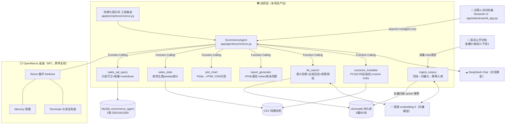

# 电商运营数据分析智能体

> 输入一句中文业务问题 → Agent 自动查数 / 统计 / 画图 → 输出带图表与出处的 HTML 分析报告。
>
> **6 个自研工具 ｜ RAG 知识库（9 篇文档 / 82 个语义块 / 平均 294 字）｜ 单次端到端 ≈ ¥0.05**

<!-- 📺 演示视频（1'40"，本地已录制：learning-notes/W4-演示视频-库存口径问答.webm）。GitHub 不内嵌 webm，需要时可随简历一并提供。 -->

## 演示

> 🎬 **演示视频（1 分 40 秒）**：一句话提问 → Agent 执行时间线 → 报告下载。**已录制，可随简历一并提供。**

## 它解决什么问题

电商运营做日常复盘时，取数靠手工导表、跨表核对、口径靠问人——**一个"上月哪个品类卖得好"要花半小时**。

本项目把这条链路压缩成**一句话**：运营人员不需要会 SQL，输入自然语言问题，即可获得带图表、带结论、**带数据来源引用**的分析报告。业务口径类问题（如"复购率怎么算"）由 RAG 知识库作答，**回答必附出处；无依据时如实说明，不编造**。

## 架构



## 核心能力

- **6 个自研工具接入 Agent**：只读 SQL 查询（**三层安全防御**）、pandas 统计分析、Plotly 交互图表、HTML 报告生成（含 token 成本页脚）、RAG 知识库检索、相似客户分析（PCA + KNN），全部由大模型自主调度（Function Calling）
- **RAG 知识库**：9 篇真实公开文档 → 82 个语义块（**幂等入库**，重跑结果一致）；回答带来源引用；**无关问题实测正确拒答**
- **检索调优**：定位切块过碎问题（平均 **40 → 294 字**）；发现向量检索分数无区分度（相关 0.842 / 不相关 0.797）后，将相关性判断交由大模型结合上下文处理
- **可观测与评测**：**19 条自动化测试用例**（14 条纯本地 / 2 条含数据库 / 3 条真实 API·live 门控；含守卫绕过与尾分号回归固化）；每步执行日志可追溯；token 成本统计
- **Web 界面**：Streamlit 一句话输入 → 回答 + 报告链接 + 执行过程展开

## 快速开始

> 以下命令以 **PowerShell**（Windows）为例。

```powershell
# 1. 依赖（★ OpenManus 基座是 uv 管理的 venv，它没有 pip）
uv pip install -r requirements.txt --python <你的 OpenManus venv 路径>\Scripts\python.exe

# 2. 初始化数据库（用 root 账号建表与灌数据）
$env:MYSQL_PASSWORD="<root 密码>"
python scripts/w2_setup/one_click_init.py

# 3a. 命令行运行（查询走只读账号）
$env:MYSQL_RO_PASSWORD="<只读账号密码>"; $env:ZHIPU_API_KEY="sk-..."
python scripts/run_agent.py

# 3b. Web 界面（★ 必须在同一终端窗口先设环境变量）
$env:MYSQL_RO_PASSWORD="<只读账号密码>"; $env:ZHIPU_API_KEY="sk-..."
python -m streamlit run app/web/streamlit_app.py
```

> ⚠️ **环境变量不跨窗口**：Streamlit 必须在**同一个终端窗口**里设好环境变量后再启动，否则会报密钥缺失。

> 🔐 **账号分工**：`MYSQL_PASSWORD`（root）仅用于**初始化建表**；`MYSQL_RO_USER` / `MYSQL_RO_PASSWORD`（只读账号，仅 `GRANT SELECT`）用于**所有查询**——数据库层兜底防御。

## 技术要点与踩坑精选

1. **切块参数"写了 ≠ 生效"**：首版切块平均仅 40 字——`max_len=500` 一次都没触发（标题太密）。改为"内容攒够 200 字再切"后升至 294 字，命中内容从"只有标题"变为完整段落。
2. **向量检索分数无区分度**：完全不相关的文档也能拿 0.797（正确答案 0.842，仅差 0.045）→ 结论：**向量检索是"排序器"不是"打分器"**，绝对分数不可靠、排序可靠；改为"分数交给模型 + 提示词授权其说'不知道'"。
3. **token 统计曾是全局累计**：LLM 是进程级单例、计数从不重置，连问第二个问题时报告页脚会变成两次之和 → **在 Agent 入口把计数清零**，每轮任务从零开始计。

## 自有模块标注（本项目产出 vs 开源底座）

**本仓库自研**：

| 模块 | 说明 |
|---|---|
| `app/tool/sales_sql_query.py` | 只读 SQL 查询 + 三层安全防御（提示词约束 / 代码守卫 / 数据库只读账号） |
| `app/tool/sales_stats.py` | 5 类预设统计（月度 / 品类 / 用户 / Top商品 / 复购率） |
| `app/tool/plot_chart.py` | 5 种 Plotly 交互图表，列名校验 + 路径返回 |
| `app/tool/report_generator.py` | HTML 报告生成（图表嵌入 + token 成本页脚 + 缺失图表降级） |
| `app/tool/kb_search.py` | RAG 语义检索（出处回显 + 相关性判断授权） |
| `app/tool/customer_lookalike.py` | 相似客户分析（特征矩阵 → 标准化 → PCA → cosine KNN） |
| `scripts/w3_setup/ingest_corpus.py` | 语料切块 → 向量化 → 幂等入库 |
| `app/agent/ecommerce.py` · `app/prompt/ecommerce.py` | Agent 装配（工具注册 / 每轮 token 计数清零）+ 场景化提示词 |
| `app/web/streamlit_app.py` | Web 界面 |
| `tests/` | 19 条自动化测试用例 |

**OpenManus 底座（MIT 协议，原样复用）**：ReAct 循环（`think` / `act`）、工具基类与注册机制、LLM 封装与单例计数、消息与记忆机制、卡死检测与 `max_steps`。

## 生产化设计说明（未实施，仅为设计）

若要把本项目容器化上线，我会这样切分：

1. **镜像分层**：`python:slim` 基础层 → 依赖层 → 应用层，依赖层可缓存复用；
2. **数据与密钥**：`knowledge/`（向量库持久目录）与 `workspace/`（图表与报告产物）挂 volume，避免容器重建丢数据；密钥经环境变量注入，**不烧进镜像**；
3. **服务编排**：`docker-compose` 起两个服务——`mysql`（含初始化脚本挂载）与 `agent`（Streamlit 界面；**API 服务化评估后暂不采用**——本项目定位是单用户演示应用，Web 框架的并发与鉴权能力用不上）；
4. **健康检查**：容器 healthcheck 探测 Web 端口与 MySQL 连通性；
5. **多阶段构建**：构建期装依赖、运行期只保留运行时依赖，压缩镜像体积。

## 数据说明

- **数据源**：MySQL `ecommerce_agent`（3 表：Customers 200 / Products 100 / Transactions 1000）+ 同源 CSV 快照（统计与 ML 工具不依赖数据库，便于离线运行）
- **三消费者两数据源**：SQL 工具读 MySQL，统计与 ML 工具读 CSV——**改一处数据必须重跑 `one_click_init.py` 全量刷新**（该脚本幂等）
- **知识库语料**：9 篇真实公开文档（金蝶官方帮助文档 5 篇 + 商业百科词条 3 篇 + 干扰项对照 1 篇），**全部人工采集，无 AI 生成内容**
- **运行产物**：`workspace/charts/` 与 `workspace/reports/` 为运行产物（带时间戳，不入库、可整体清空重跑）
- **报告可转发**：HTML 报告单文件自包含（图表内联），可直接发给运营同事；**打开需联网**（plotly.js 走 CDN——10KB 体积与离线可用的取舍）

## 二次开发深度验收清单

- [x] 自研工具 ≥ 4 个（实际 6 个）
- [x] 自建知识库（9 篇真实文档，非 AI 生成）
- [x] 场景化提示词（角色定位 / 工具分流 / 输出约束）
- [x] README 标注自有模块
- [x] 自动化测试用例（19 条）
- [x] 三层安全防御（含实测证据：只读账号 `DROP` 被拒）

## 致谢与许可

基于 [OpenManus](https://github.com/FoundationAgents/OpenManus)（MIT 协议）二次开发。本项目代码以 MIT 协议开源。
